<!-- order: 3 -->
<!-- description: Odyssey's right-handed, Y-up 3D frame and its 2D aimpoint, compared with Unity, Unreal, Godot, Bevy and Blender, with conversions. -->

# Coordinate system

Odyssey describes a device in two ways:

- **In 3D**, the **pose**: where the device is in front of the screen and which
  way it points, in meters.
- **In 2D**, the **aimpoint**: where on the screen it is aimed, as a fraction of
  the screen.

## 3D: right-handed, Y up

Odyssey uses a **right-handed, Y-up** coordinate system, in **meters**, with
its origin at the **top-left corner of the screen**:

- **+X** points right, along the top edge of the screen.
- **+Y** points up.
- **+Z** points out of the screen, toward the shooter. A device therefore
  looks along **−Z**, into the screen.



It is the same convention as Bevy, Godot, three.js, and OpenGL. Unity flips the
Z axis; Unreal Engine and Blender put Z up.

To check a convention, make the sign with your hand: thumb along +X, index
finger along +Y, middle finger along +Z. Odyssey's axes fit your right hand,
with the middle finger pointing at you; Unity's fit your left hand.


What this means in practice:

- A shooter in front of the screen has a **positive `translation.z`**: their
  distance from the plane of the screen.
- Anywhere below the top edge has a **negative `translation.y`**. The middle of
  a 1.6 m × 0.9 m screen is at `(0.8, -0.45, 0)`.
- **Up is the screen's up.** On a tilted screen, Y tilts with it.
- **Each screen has its own origin.** When `screen_id` changes, positions are
  measured from the new screen's top-left corner.

### Position

`pose.translation` (`x`, `y`, `z`) is the position of the device's tracking
camera, in meters. Zeroing never changes it.

### Orientation

`pose.rotation` is a 3×3 rotation matrix with entries `m11` to `m33` (row,
column). It turns directions on the device into directions in the screen's
frame, and its columns are the device's own axes:



The device's line of sight, the way its tracker looks, is its −Z axis:

```text
line of sight = (-m13, -m23, -m33)
```

A device held level and aimed straight at the screen has the identity rotation:
its axes line up with the screen's.

> [!NOTE]
> The tracker's line of sight is never exactly parallel to the bore.
> [Zeroing](./zeroing.md) corrects the aimpoint for that, but not the pose, so
> for scoring use the aimpoint.

## 2D: the aimpoint

Like UI and image coordinates in most engines, the aimpoint has its origin at
the **top-left** and its y axis pointing **down**. It is a fraction of the
screen, so it does not depend on resolution.



To get a pixel, multiply by the size of what is being shot at. Where the
pixel origin is the top-left, as in Unreal Engine, Godot, Bevy, and most 2D and
UI APIs:

```text
pixel = (aimpoint.x * width, aimpoint.y * height)
```

Where it is the bottom-left, as in Unity's `Screen` coordinates and OpenGL,
flip y:

```text
pixel = (aimpoint.x * width, (1 - aimpoint.y) * height)
```

The aimpoint already includes the device's [zero](./zeroing.md). On a curved or
irregular display measured during calibration, it follows the measured
surface.

## Screen corners

`get_screen_info_by_id` returns a screen's corners, `tl`, `tr`, `bl`, and `br`,
in meters. They come from the screen calibration, which measures **y
downward**, unlike the pose. To use a corner in the pose's frame, negate its y:

```text
corner in the pose's frame = (corner.x, -corner.y, 0)
```

For a screen calibrated with Odyssey Desktop's automatic calibration, `tl` is
`(0, 0)` and `br` is `(width, height)`. Read the corners rather than assuming
this.

## Converting to your engine

Positions are relative to the screen's top-left corner. Place an object at your
scene's screen corner and parent tracked objects to it.

| Odyssey | Unity | Unreal Engine | Godot, Bevy |
|---|---|---|---|
| +X, right | +X | +Y | +X |
| +Y, up | +Y | +Z | +Y |
| +Z, toward the shooter | −Z | −X | +Z |
| meters | meters | centimeters, × 100 | meters |

<!-- tabs: engine -->

**Unity**

```csharp
using UnityEngine;
using Ohc = OdysseyArm.HubClient;

static class OdysseyToUnity
{
    // Unity is left-handed: flip z.
    public static Vector3 Position(Ohc.uniffi.Pose pose) =>
        new Vector3(pose.Translation.X, pose.Translation.Y, -pose.Translation.Z);

    // Forward (+Z) is the device's line of sight; up (+Y) is its top.
    public static Quaternion Rotation(Ohc.uniffi.Pose pose)
    {
        var r = pose.Rotation;
        return Quaternion.LookRotation(
            new Vector3(-r.M13, -r.M23, r.M33),
            new Vector3(r.M12, r.M22, -r.M32));
    }
}
```

**Unreal Engine**

```cpp
#include <ohc.hpp>

// Odyssey: meters, right-handed, +Y up, +Z toward the shooter.
// Unreal:  centimeters, left-handed, +Z up, +X forward.
static FVector ToUnreal(float X, float Y, float Z) { return FVector(-Z, X, Y); }

FVector OdysseyLocation(const ohc::Pose& Pose)
{
    return ToUnreal(Pose.translation.x, Pose.translation.y, Pose.translation.z) * 100.0;
}

// Forward (+X) is the device's line of sight; up (+Z) is its top.
FQuat OdysseyRotation(const ohc::Pose& Pose)
{
    const auto& R = Pose.rotation;
    const FVector Forward = ToUnreal(-R.m13, -R.m23, -R.m33);
    const FVector Up = ToUnreal(R.m12, R.m22, R.m32);
    return FRotationMatrix::MakeFromXZ(Forward, Up).ToQuat();
}
```

**Godot**

```csharp
using Godot;
using Ohc = OdysseyArm.HubClient;

static class OdysseyToGodot
{
    // Same axes and units as Odyssey: copy the matrix across as-is.
    public static Transform3D Transform(Ohc.uniffi.Pose pose)
    {
        var r = pose.Rotation;
        var t = pose.Translation;
        var basis = new Basis(
            new Vector3(r.M11, r.M21, r.M31),
            new Vector3(r.M12, r.M22, r.M32),
            new Vector3(r.M13, r.M23, r.M33));
        return new Transform3D(basis, new Vector3(t.X, t.Y, t.Z));
    }
}
```

**Bevy**

```rust
use bevy::prelude::*;
use odyssey_hub_common::events::Pose;

/// Same axes and units as Odyssey: copy the matrix across as-is.
fn odyssey_transform(pose: &Pose) -> Transform {
    let r = &pose.rotation;
    let rotation = Mat3::from_cols(
        Vec3::new(r.m11, r.m21, r.m31),
        Vec3::new(r.m12, r.m22, r.m32),
        Vec3::new(r.m13, r.m23, r.m33),
    );
    let t = &pose.translation;
    Transform::from_xyz(t.x, t.y, t.z).with_rotation(Quat::from_mat3(&rotation))
}
```

<!-- /tabs -->

In Godot and Bevy, a camera or node looks along −Z, just like the device, so a
camera given this transform looks where the device looks.

## Quick reference

| Value | Measured in | Axes |
|---|---|---|
| `aimpoint` | fractions of the screen, from its top-left corner | x right, y **down** |
| `pose.translation` | meters, from the screen's top-left corner | x right, y **up**, z toward the shooter |
| `pose.rotation` | its columns are the device's axes | right, up, back (line of sight is −Z) |
| Screen corners | meters, usually from the top-left corner | x right, y **down** |
| `distance` | meters, from the device | along its line of sight |
